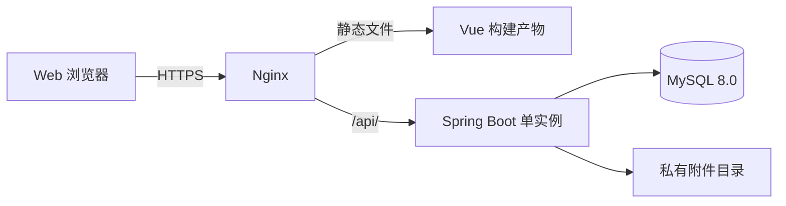

# 考试管理系统

## 项目背景

本项目是一个面向高校的考试管理系统，作为期末课程项目按业务流程逐步实现。一个主办方可以统筹多个高校考点，集中维护考试科目、报考项目、场次和报名信息。考务人员按授权范围办理业务，系统管理员负责内部账号、权限和审计。

考生可在 Web 门户浏览考试公告、注册登录、选择考点并查询自己的报名记录。社会考生可自主选择开放考点。在校考生所在学校有可报考点时，系统优先推荐本校考点，考生仍可改选。项目最终覆盖考试发布、报名、排考、准考证和成绩查询。

Web 目前已实现门户资讯、考生账号与报名、基础目录和场次维护、后台报名名单、资讯发布与附件管理，以及内部账号授权与审计。排考和成绩已有 Web 页面入口，相关后端和考生准考证查询待开发。微信小程序目前是 JavaScript 初始工程，微信身份登录、账号绑定和个人业务页面待接入。

## 技术路线

- **Web**（`web/`）使用 Vue 3、Vue Router、Vite、Element Plus 和 JavaScript。门户、考生服务和管理后台共用一个 SPA，根据登录状态和权限提供各自的入口。
- **后端**（`server/`）使用 Java 21、Spring Boot 4、Spring Security、MyBatis-Plus 和 Maven。单体服务按认证授权、考试、报名、资讯、审计等业务模块分包，通过 `/api/v1` 提供 REST API。
- **数据**使用 MySQL 8.0（项目基线为 8.0.44）和 InnoDB。报名窗口、重复报名及名额由服务端校验，报名写入与占额在同一事务内完成。建表、权限字典和现有库升级脚本位于 `docs/`。
- **权限**采用服务端 Session、Cookie 和 CSRF 防护，密码使用 Argon2id 哈希。后台按动作与资源范围授权，并记录关键操作的审计事件。
- **微信小程序**（`wechat_project/`）使用微信原生 JavaScript、WXML 和 WXSS。后续经 HTTPS 调用同一套后端，复用系统考生身份和业务数据。

## 本地运行

准备 JDK 21、MySQL 8.0 和 npm。Node.js 版本按 `web/package.json` 选择 22.18+ 的 22.x，或 24.12 及以上。Maven 由项目自带的 Wrapper 提供。

### 1. 初始化数据库

从项目根目录用有建库权限的 MySQL 账号进入客户端，例如 `mysql -u root -p --default-character-set=utf8mb4`。新环境选择专用空库，依次执行下列语句。每个脚本执行成功后再继续下一步。 [MySQL 脚本执行说明](https://dev.mysql.com/doc/refman/8.0/en/mysql-batch-commands.html)

```sql
CREATE DATABASE exam_system CHARACTER SET utf8mb4 COLLATE utf8mb4_0900_ai_ci;
USE exam_system;
SOURCE docs/database-schema.sql;
SOURCE docs/database-role-seed.sql;
```

使用应用专用 MySQL 账号连接该库。权限字典脚本只初始化角色和动作，内部账号通过下方的交互命令创建。旧库升级按 [数据库升级](#数据库升级) 处理。

### 2. 启动后端

首次本地运行时，将 `server/src/main/resources/application.properties.example` 复制为同目录的 `application.properties`，填写 `spring.datasource.url`、`spring.datasource.username` 和 `spring.datasource.password`。已有本地配置可直接使用。

在 `server/` 下运行以下 PowerShell 命令。首次初始化管理员时先执行第二行，然后执行第三行启动服务。已有管理员的库直接启动。初始化命令在交互终端读取账号和密码。

```powershell
.\mvnw.cmd -B clean compile jar:jar spring-boot:repackage
java -jar target/server-0.0.1-SNAPSHOT.jar --app.bootstrap-admin=true
java -jar target/server-0.0.1-SNAPSHOT.jar --server.address=127.0.0.1
```

### 3. 启动 Web

在另一终端进入 `web/`，开启真实 API 模式。Vite 将 `/api` 转发至本机后端。浏览器访问 `http://127.0.0.1:5173`，管理入口为 `/admin/login`。

```powershell
npm ci
$env:VITE_USE_MOCK = 'false'
$env:EXAM_API_TARGET = 'http://127.0.0.1:8080'
npm run dev -- --host 127.0.0.1 --port 5173 --strictPort
```

新库的门户从空数据开始。首次登录后台后，按需创建并授权考务账号，再由有权限的人员维护目录、发布考试场次和资讯。

## 服务器部署方案

首版建议采用 Linux 单机部署。Nginx 对外提供 HTTPS 和 Web 静态文件，并将同域 `/api/` 请求转发给单实例 Spring Boot。MySQL 和后端端口仅供本机访问。路径和域名为部署示例。



### 构建与配置

1. 在干净的源码副本构建生产包，应用凭据通过服务器外部配置加载。在 `server/` 下执行 `sh ./mvnw -B clean compile jar:jar spring-boot:repackage`（Windows 使用 `.\mvnw.cmd`）。将生成的 JAR 上传到 `/opt/exam-system/server.jar`。在 `web/` 下执行 `npm ci` 和 `npm run build`，将 `dist/` 内容发布到 `/var/www/exam-system/`。
2. 将 `application.properties.example` 复制到服务器 `/etc/exam-system/application.properties`，保留其中的 Mapper、会话和上传限制等基础配置，填入服务器实际数据源。配置文件限制为管理员和运行服务的账号可读。 [Spring Boot 外部配置](https://docs.spring.io/spring-boot/reference/features/external-config.html)
3. 在外部配置中设置以下生产参数。创建附件目录并授予后端服务账号读写权限。附件由后端按业务规则提供下载，目录置于 Web 静态根目录之外。

   ```properties
   server.address=127.0.0.1
   server.port=8080
   server.forward-headers-strategy=native
   server.servlet.session.cookie.secure=true
   app.portal.attachment-root=/var/lib/exam-system/notice-attachments
   ```

### 启动应用

新环境先完成[数据库初始化](#1-初始化数据库)。新库在交互式终端以服务账号执行一次管理员初始化。

```bash
java -jar /opt/exam-system/server.jar \
  --spring.config.additional-location=file:/etc/exam-system/application.properties \
  --app.bootstrap-admin=true
```

日常运行可由 systemd 托管。以专用服务账号运行，`ExecStart` 指向以下命令，并通过服务日志查看启动状态。

```bash
/usr/bin/java -jar /opt/exam-system/server.jar --spring.config.additional-location=file:/etc/exam-system/application.properties
```

### 配置 HTTPS 入口

将 `exam.example.com` 和证书路径替换为实际值。`try_files` 支持刷新前端页面时回到 SPA 入口。`proxy_pass` 保留 `/api/v1` 请求路径，上传请求上限须容纳后端允许的 11 MB multipart 请求。 [Nginx 反向代理](https://nginx.org/en/docs/http/ngx_http_proxy_module.html#proxy_pass) · [Nginx 静态路由与上传限制](https://nginx.org/en/docs/http/ngx_http_core_module.html)

```nginx
server {
    listen 80;
    server_name exam.example.com;
    return 301 https://exam.example.com$request_uri;
}

server {
    listen 443 ssl;
    server_name exam.example.com;
    ssl_certificate /path/to/fullchain.pem;
    ssl_certificate_key /path/to/privkey.pem;
    root /var/www/exam-system;

    location / {
        try_files $uri $uri/ /index.html;
    }

    location /api/ {
        client_max_body_size 12m;
        proxy_pass http://127.0.0.1:8080;
        proxy_set_header Host $host;
        proxy_set_header X-Forwarded-For $remote_addr;
        proxy_set_header X-Forwarded-Proto $scheme;
    }
}
```

### 数据库升级

已运行的环境先备份数据库和私有附件。仅在旧库尚未包含资讯管理字段及权限时，在部署新版后端前对该库执行一次 [资讯管理增量脚本](docs/database-notice-admin-migration.sql)。新建库的建表和字典脚本已包含相关结构。升级和回滚时，应用版本、数据库结构与附件备份需要对应。

现有库若还没有 `notice_attachment.withdrawn_at`，部署前执行一次 [附件下架增量脚本](docs/database-notice-attachment-withdrawal-migration.sql)。旧版后端会忽略该字段，启用附件下架后回滚应用时需同时处理已下架附件的公开可见性。

### 微信小程序

当前可用微信开发者工具导入 `wechat_project/` 查看初始工程。待登录、账号绑定及业务 API 接入后，再配置微信公众平台的 HTTPS 请求合法域名，并通过开发者工具上传、审核和发布。AppSecret 由后端部署环境保管。

以上为部署方案和配置示例，实际服务器部署与功能验收待开展。
